# Solution — Secure Feature Delivery

**Module 3 (Git) end-of-module capstone.** A single end-to-end DevSecOps workflow: lock down the repository, deliver a feature with signed commits, intentionally introduce a secret, detect it, and respond correctly — proving the whole flow holds together.

---

## 1. Repository lockdown — rulesets

I protected the repo with **two rulesets**, scoped by what each branch is *for*.

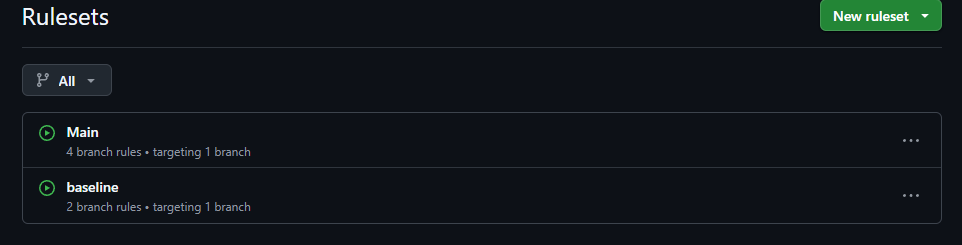

### Main ruleset — restrictive (the default / production branch)
More restrictive rules to limit unwanted modifications to the production branch:

- **Restrict deletions** — prevent anyone from accidentally (or maliciously) deleting the `main` branch.
- **Require signed commits** — only accept commits from verified contributors, minimizing spoofing. A username/email can be configured as anyone without verification, so the cryptographic signature is what actually proves authorship.
- **Require a pull request before merging** — force every change through a review gate so errors are caught before they reach production.
- **Block force pushes** — prevent unchecked history rewrites on production.

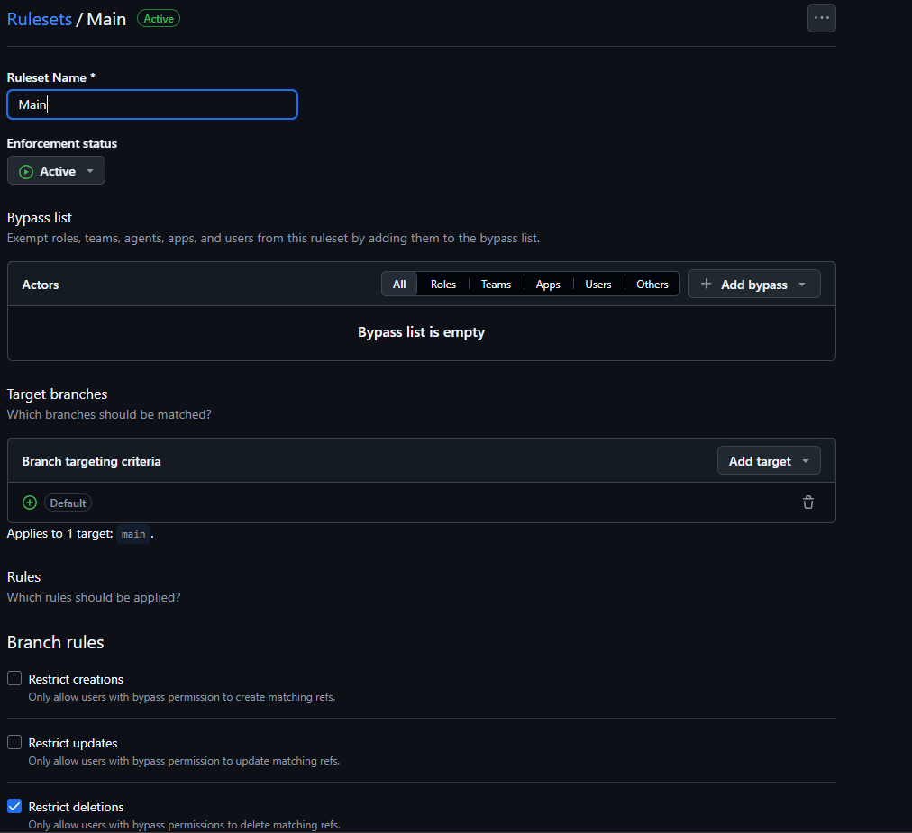

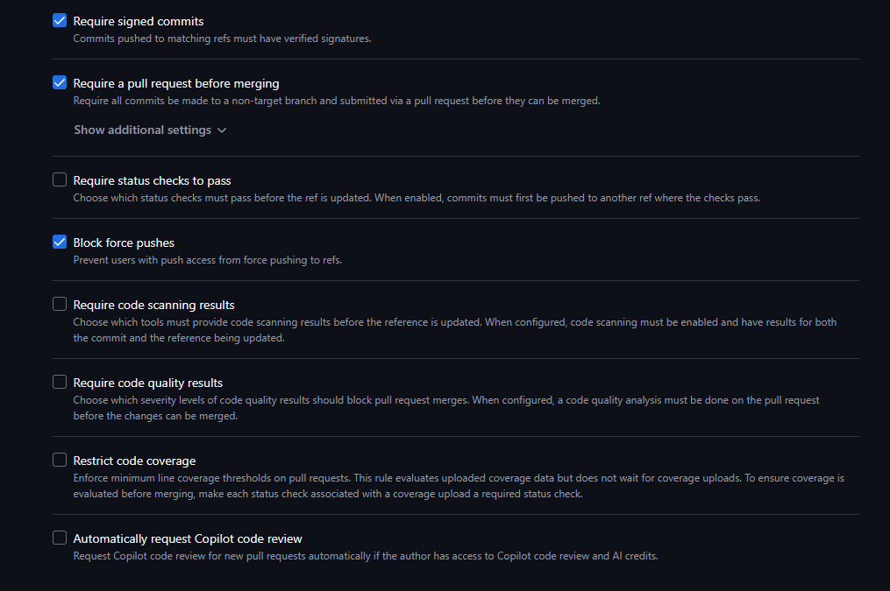

### Baseline ruleset — minimal (all branches)
The bare-minimum set of rules applied to **every** branch:

- **Require signed commits** — enforce verified authorship on all branches, not just `main`.
- **Block force pushes** — stop history rewrites / unverified pushes anywhere.

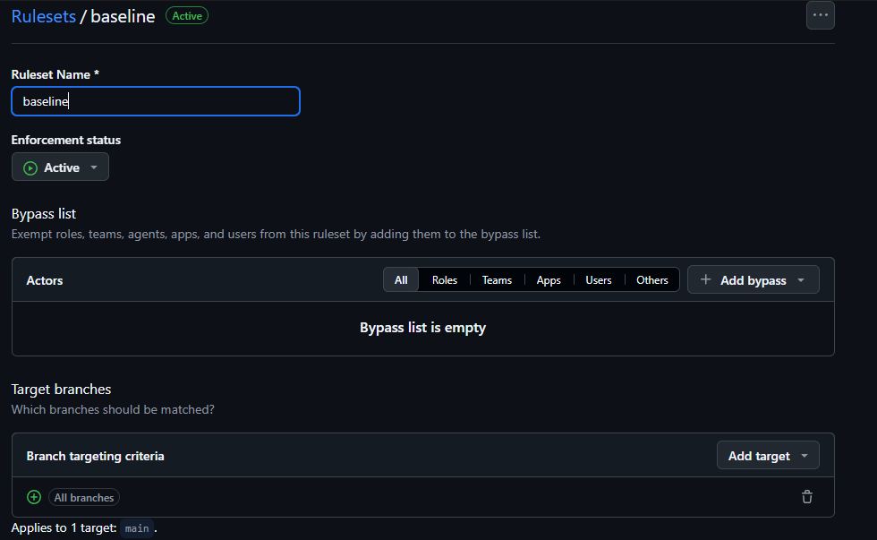

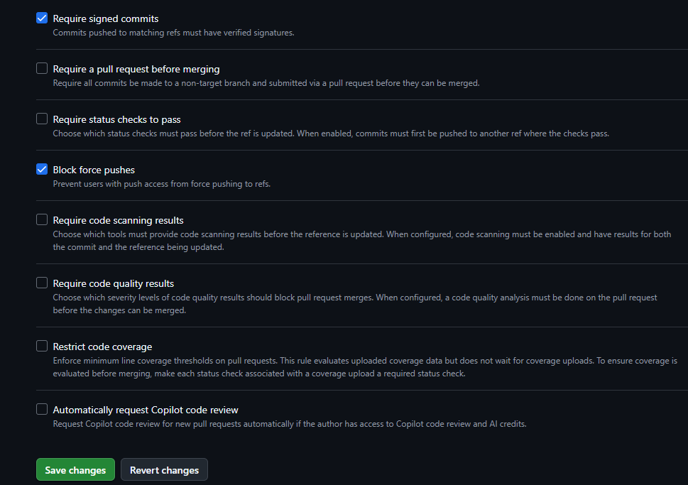

> **Why split them?** Rules that protect the *permanent* production branch (restrict deletions, require a PR) are scoped to `main`, while universal integrity rules (signed commits, no force-push) apply to every branch. Feature branches stay flexible; `main` stays guarded.

### Verifying the lockdown works
A direct push to `main` is rejected — changes must go through a pull request (`GH013`):

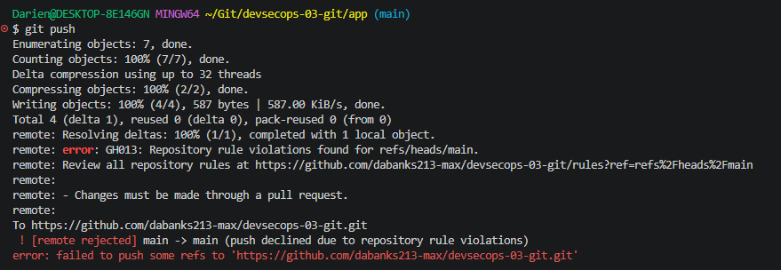

---

## 2. Signed commits

Every commit is signed with my SSH key and verifies cleanly:

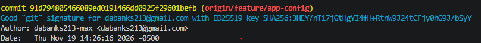

`Good "git" signature ... with ED25519 key` confirms the commit is cryptographically tied to my key — not just plain-text authorship, which can be spoofed.

---

## 3. The mistake — committing a secret (locally)

Working on a feature branch, I generated a realistic fake secret and wrote it into `app/config.yaml`:

```bash
echo "GITHUB_TOKEN=ghp_$(tr -dc 'A-Za-z0-9' </dev/urandom | head -c 36)" > config.yaml
```

The `/dev/urandom` value is a high-entropy string that looks like a real GitHub token, so it will actually trip Gitleaks (a low-entropy placeholder gets filtered out). **This was done entirely locally and never pushed**, keeping the public repo's history clean.

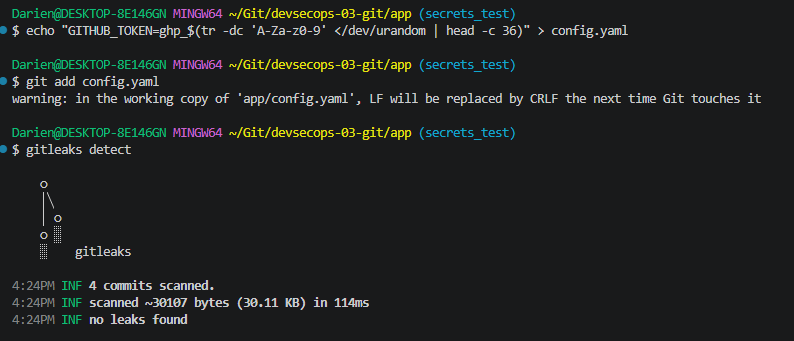

> **Note:** `gitleaks detect` scans **committed history**, so while the secret was only *staged* it reported "no leaks found." It flags once the secret is actually committed (next step).

---

## 4. Detection — Gitleaks

After committing, Gitleaks caught it:

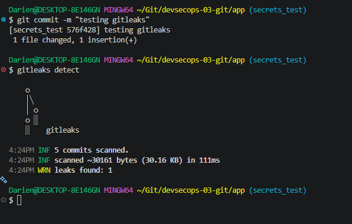

`leaks found: 1` — rule `github-pat`, located at `app/config.yaml`, line 1. Caught **locally, before the secret ever left my machine**.

---

## 5. Response — clean + rotate

Because the secret was caught **locally and unpushed**, the fix was a simple history rewrite with `reset` — no `git filter-repo` needed (that's only required for secrets already pushed or distributed):

```bash
git reset HEAD~1          # undo the secret commit; the file returns to the working dir (unstaged)
# remove the secret from config.yaml
git add config.yaml
git commit -m "add app config (no secret)"
gitleaks detect           # -> no leaks found
```

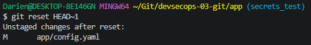

**Rotation.** In a real incident — a genuine credential pushed to a remote — the *first* action would be to **rotate it** (invalidate the old credential, issue a new one), because a pushed secret must be assumed scraped within seconds. History scrubbing is cleanup; rotation is the actual fix. Here the secret was fake and never left my machine, so rotation wasn't required, but the response order is the rule: **rotate → scrub → prevent**.

**Key lesson lived.** Deleting the file in a *new* commit does **not** remove the secret — the old commit still points to the blob (Merkle chain). You have to rewrite or replace the commit that contains it (`reset` / `amend`), which is exactly what cleared the Gitleaks warning.

---

## 6. Ship the clean feature through the gate

The cleaned feature branch is merged into `main` through a **pull request**, satisfying the Main ruleset (PR required, signed commits, no force-push). `main` only ever receives the reviewed, secret-free version.

<!-- Add your PR-merge screenshot here, e.g.: 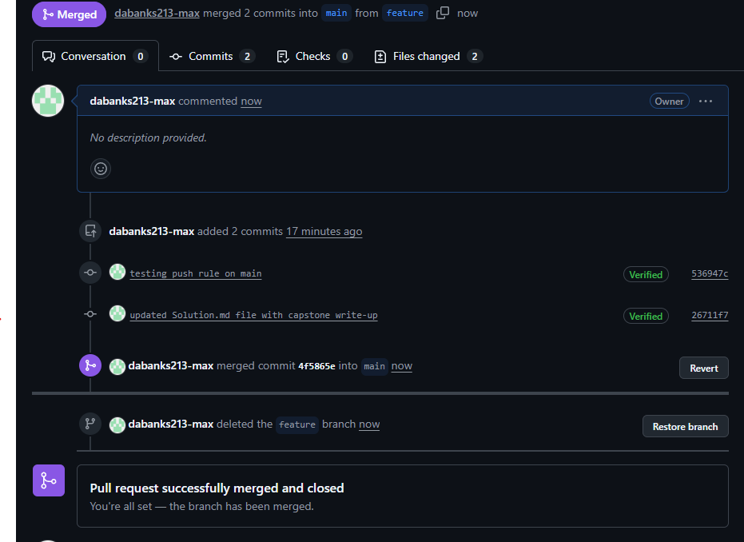 -->

---

## 7. Verification / audit trail

- `gitleaks detect` → **clean** on the final state.
- `main` is protected: direct pushes are rejected (`GH013`), and every change arrives via PR with a signed, verified commit.
- The history shows the feature delivered cleanly, with **no secret in `main`'s history**.

---

## Reflection

This capstone chained every piece of Module 3 into one workflow:

- **Object model (3.1)** — understanding *why* a deleted-but-committed secret persists (the old commit still points to the blob).
- **Workflows & branch protection (3.2)** — rulesets, PR gates, and `GH013` rejecting direct pushes.
- **Remotes (3.3)** — pushing branches and merging through the remote.
- **Undoing (3.4)** — `reset` to rewrite an unpushed commit, vs. `revert` / `filter-repo` for distributed history.
- **Secrets (3.5)** — Gitleaks detection (pattern + entropy), the rotate-first response, and local prevention.

The biggest hands-on takeaway: **secret remediation depends on where the secret is.** Local and unpushed → `reset` and re-commit. Pushed or distributed → rotate immediately, then scrub with `filter-repo`. And in every case, catching it early (pre-commit / local) is cheaper than every step that follows.